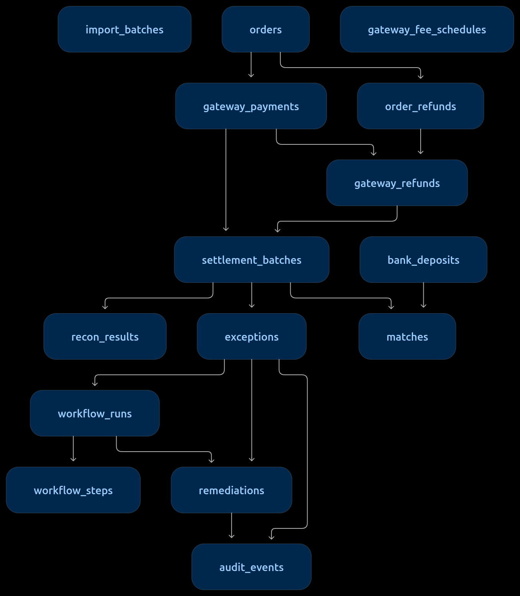

# Payment Settlement Investigation Agent
> Autonomous Financial Reconciliation, Bounded AI Exception Investigation, and Human-In-The-Loop Remediation.

The Payment Settlement Investigation Agent is a production-grade financial platform that reconciles gateway payouts, internal ledger entries, and bank statements with deterministic integer-paise precision. When discrepancies arise, a bounded autonomous AI agent investigates root causes across external APIs and ledger records, produces evidence-backed diagnoses, and drafts actionable remediation entries for human operator sign-off.

---

## 🛠️ Tech Stack

* **Backend Engine:** Go 1.23, Chi HTTP Router, `pgx/v5` PostgreSQL driver, Goose database migrations.
* **Database & Persistence:** PostgreSQL 16 with raw SQL, atomic transactions, foreign keys, and unique indexes.
* **Frontend Workstation:** React 18, TypeScript, Mantine UI v7, Tabler Icons, TanStack Query v5 (React Query).
* **AI & Agent Architecture:** Pluggable LLM interface supporting Anthropic Claude (3.5 Sonnet), Google Gemini (1.5 Pro / Flash), OpenAI (GPT-4o), local Ollama (Llama 3.1), and an offline deterministic `FakeLLM`.
* **Precision & Safety:** Integer paise math (`money.Minor`), SHA-256 idempotency hashing, strict Evidence Registry, and multi-turn bounded execution limits (max 6 tool calls, 8 turns, 90s timeout).
* **Infrastructure:** Docker & Docker Compose.

---

## 📂 Project Structure & Key Files

The repository is cleanly split into **`backend/`** and **`frontend/`**:

```text
settlement-agent/
├── backend/                             # Core Go application & database layer
│   ├── cmd/
│   │   ├── api/main.go                  # Server startup, Goose migrations, static router
│   │   └── seedgen/main.go              # Deterministic synthetic fixture generator CLI
│   ├── internal/
│   │   ├── agent/                       # Multi-turn bounded AI loop & tool definitions
│   │   │   ├── loop.go                  # Turn-by-turn orchestrator & budget guardrails
│   │   │   ├── tools.go                 # Executable tool logic & database query runner
│   │   │   ├── schemas.go               # Anthropic / OpenAI tool calling JSON schemas
│   │   │   ├── evidence.go              # Strict evidence token registry (hallucination barrier)
│   │   │   ├── llm.go                   # Pluggable LLM interface & message data structures
│   │   │   └── prompt.go                # System prompt, investigation prompt & guardrails
│   │   ├── recon/                       # Deterministic 3-way reconciliation engine
│   │   │   ├── engine.go                # Pure calculation pipeline (B vs R vs E)
│   │   │   ├── classify.go              # Mathematical variance classification rules
│   │   │   ├── deposits.go              # Bank candidate window & deposit matching
│   │   │   └── store.go                 # Transactional database loading and output persistence
│   │   ├── remediation/service.go       # HITL remediation drafting, execution, idempotency
│   │   ├── ingest/                      # CSV parser, validation, and SHA-256 deduplication
│   │   ├── mocks/                       # Mock Gateway and Accounting APIs with failure injectors
│   │   ├── money/money.go               # Integer paise currency math (no floating-point rounding)
│   │   └── config/config.go             # Environment variable loader (.env discovery)
│   ├── migrations/001_init.sql          # 15 normalized PostgreSQL tables, indexes, & constraints
│   ├── seed/                            # 7 CSV fixtures for 3-way matching demo scenarios
│   ├── init-test-db.sh                  # Automated script to create settlement_test database
│   ├── go.mod & go.sum                  # Go module definition & locked dependencies
│   └── .env.example                     # Environment configuration template
│
├── frontend/                            # React 18 Operator Workstation
│   ├── src/
│   │   ├── components/
│   │   │   ├── Header.tsx               # System status, seed loader, recon trigger, role switch
│   │   │   ├── SummaryCards.tsx         # Real-time financial volume, variance & health KPIs
│   │   │   ├── ExceptionTable.tsx       # Filterable exception queue with Investigate triggers
│   │   │   ├── InvestigationDrawer.tsx  # Split-view workspace (decomposition + agent trace)
│   │   │   ├── VarianceBreakdown.tsx    # Formula breakdown (Variance = B - E)
│   │   │   ├── AgentTrace.tsx           # Accordion displaying turn-by-turn tool executions
│   │   │   ├── RemediationPanel.tsx     # HITL Approve / Reject / Retry action cards
│   │   │   ├── AuditDrawer.tsx          # Append-only immutable regulatory audit ledger
│   │   │   └── DevToolsBar.tsx          # Chaos engineering controls & sync/async switch
│   │   ├── api/client.ts                # Typed API client with Bearer auth injection
│   │   ├── types/index.ts               # Shared TypeScript schemas matching Go backend
│   │   └── App.tsx                      # Main dashboard coordinator & query subscriptions
│   ├── dist/                            # Production-compiled assets served directly by Go
│   ├── package.json & vite.config.ts    # Frontend dependencies and Vite build configuration
│   └── index.html                       # Application shell and font imports
│
├── docs/                                # Architecture diagrams & documentation
│   ├── db.png                           # Relational database schema & dataflow diagram
│   ├── agent_execution_sequence.png     # Multi-turn agent sequence diagram
│   └── SETUP_GUIDE.md                   # Comprehensive operational setup & UI guide
├── docker-compose.yml                   # PostgreSQL 16 container definition
└── .env.example                         # Environment configuration template
```

---

## 🗄️ Database Architecture & Schema Design

The platform uses a normalized 15-table relational schema in PostgreSQL 16 to support end-to-end 3-way reconciliation (Orders $\leftrightarrow$ Gateway Payouts $\leftrightarrow$ Bank Statements), bounded AI execution tracking, and append-only audit logging:

<p align="center">
  
</p>

---

## 🤖 Features of the Agent & Capabilities

The Autonomous Investigation Agent operates under strict **bounded execution guardrails** (maximum 6 tool calls, 8 LLM turns, 90-second timeout, 3 consecutive error limit):

1. **Deterministic Variance Classification:** Evaluates batches against the fundamental accounting equation:
   $$\text{Variance} = \text{Bank Received } (B) - \text{Expected Net } (E)$$
2. **Autonomous Tool-Based Investigation:** The agent dynamically uses 4 structured tools:
   * `inspect_gateway_config`: Inspects fee schedules, rate tables, and dispute records.
   * `search_adjacent_ledger_entries`: Searches unlinked bank transactions, internal orders, or refunds.
   * `draft_remediation_entry`: Drafts proposed remediation entries (only citing verified evidence).
   * `submit_conclusion`: Finalizes the run with an authoritative explanation and cited tokens.
3. **Four Golden Exception Scenarios Handled:**
   * **Fee Overcharge (`FEE_VARIANCE`):** Identifies premature gateway tier fee changes $\to$ drafts `FEE_INQUIRY` dispute ticket.
   * **Split / Delayed Deposit (`DELAYED_OR_SPLIT_DEPOSIT`):** Finds unlinked deposit tranche in bank statement $\to$ drafts `SETTLEMENT_LINK` adjustment.
   * **Refund Omitted from Ledger (`REFUND_NOT_IN_LEDGER`):** Detects customer refund processed by gateway but forgotten in internal accounting $\to$ drafts `JOURNAL_ENTRY_DRAFT`.
   * **Overdue Missing Deposit (`MISSING_DEPOSIT`):** Verifies settlement grace window has expired and $₹0$ arrived $\to$ safely escalates to human treasury ops (`INSUFFICIENT_EVIDENCE`).
4. **Human-In-The-Loop (HITL) Safety Gate:** The agent **never** transfers money or modifies ledger state autonomously. It drafts proposals requiring human operator review (`Alice`), complete with SHA-256 idempotency keys.
5. **Role-Based Access Control (RBAC):** Strict separation between **Operator** (can investigate and execute remediations) and **Viewer** (read-only auditor view, mutative endpoints return `403 Forbidden`).
6. **Immutable Audit Ledger:** Every recon run, tool execution, operator decision, and mock dispatch is permanently logged to `audit_events`.

---

## 🚀 Quickstart & Docker-Based Deployment

The platform is fully containerized. You can run the complete stack (PostgreSQL 16 database + Go API backend + React 18 UI) with a single command.

### Mode 1: 1-Command Docker Deployment (Recommended)
```bash
# Start all services (Database + API Backend + React Workstation)
docker compose up -d --build
```
* **Localhost Access:** Open [http://localhost:8080/](http://localhost:8080/)
* **Office Network / Private IP Demo:** Open `http://<YOUR_PRIVATE_IP>:8080/` (find via `hostname -I | awk '{print $1}'`) so colleagues and evaluators on the office Wi-Fi can view and interact with the workstation live!

---

### Mode 2: Manual Local Development
If you prefer running the Go backend natively on your host machine:
```bash
# 1. Start the PostgreSQL 16 database
docker compose up -d db

# 2. Build and run the Go backend server (automatically mounts the frontend)
cd backend
go build -o bin/api ./cmd/api
./bin/api

# 3. Open your browser
http://localhost:8080/
```

For the comprehensive step-by-step setup walkthrough, environment configurations, and interactive UI verification flow, please see:

👉 **[SETUP_GUIDE.md](./docs/SETUP_GUIDE.md)**

